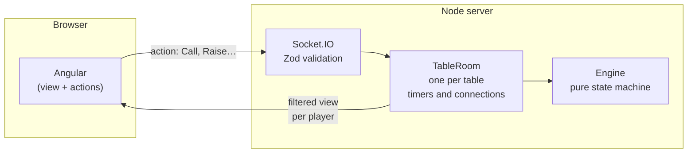

<div align="center">

# Solo Poker

**Texas Hold'em with friends, right in your browser, no sign-up.**
Create a table, share the link and the game starts as soon as everyone is seated.

[](https://github.com/indentando/solo-poker/actions/workflows/ci.yml)
[](LICENSE)


[Español](README.md) · **English**


</div>

## What it is

Solo Poker is a web app for private **No-Limit Texas Hold'em** games with friends. No accounts, no downloads: pick a name and an icon, create a password-protected table and share the link. Chips are virtual, but they are shown as real euro amounts so the game feels like a home game.

The design is deliberately minimal: black background, thin type and nothing that distracts from the cards. On a phone everything fits in one column; on a computer the game turns into an oval table.

> The app's interface is in Spanish; poker actions use the usual English terms (*Fold, Check, Call, Raise, All-in*).

<div align="center">
&nbsp;
&nbsp;
&nbsp;

</div>

## Features

**The game**
- Full No-Limit Texas Hold'em: blinds, rotating dealer button, minimum raise, all-ins and **side pots** when several players are all-in for different amounts.
- The fine print is handled too: a short all-in doesn't reopen the betting, heads-up blind rules, uncalled bets are returned and odd chips in split pots go to the right player.
- Blinds go up every 10 minutes, players are eliminated when they run out of chips, and the last one standing wins.
- 30 seconds per turn: when time runs out the player checks if possible, otherwise folds.

**The table**
- Tables for 2 to 9 players with a short id (`K7X-92Q`) and a password.
- Shareable link, with or without the password included.
- Automatic reconnection: if your phone locks or you lose signal, you have 45 seconds to come back without losing your seat.
- Every player picks an **icon**: 12 flat presets or any emoji. No duplicates at the same table.
- Short, minimal **sounds** for every action (check, bet, fold, dealing, time warning…), generated in the browser itself, with a mute button.

**Design**
- Mobile-first, with a horizontal layout on large screens.

<div align="center">

</div>

## How it's built

| Layer | Technology |
|---|---|
| Language | TypeScript everywhere (npm workspaces monorepo) |
| Game engine | Pure TypeScript, no dependencies, tested with Vitest |
| Server | Node.js + Socket.IO, validation with Zod |
| Web | Angular 22 (standalone components + signals), Tailwind CSS 4 |
| Sound | Web Audio API: synthesized in the browser, no audio files |
| CI | GitHub Actions: types, tests and build on every push |

### Architecture



Three decisions drive the design:

1. **The server is the single source of truth.** It shuffles, deals, validates every action and decides who wins. The browser only sends intentions ("I want to raise to €0.40") and renders what it receives.
2. **Each player only receives their own view.** The full state is never sent: opponents' cards and the deck never leave the server until the showdown. Not even the browser dev tools let you cheat.
3. **The engine is pure and deterministic.** It's a state machine `(state, action) → (new state, events)` with no networking or timers. Randomness and time are injected, so it can be tested thoroughly. It includes a test that plays 40 full games with random actions and checks after every action that no chips are created or lost.

### Structure

```
packages/
  engine/     Poker rules: hands, betting, pots, hand evaluator
  protocol/   Shared client-server contract: events, types and validation
apps/
  server/     Socket.IO server: in-memory tables, turns, reconnection, security
  web/        Angular app: home, create and join, waiting room and table
```

## Run it locally

You need **Node.js 22** or later.

```bash
git clone https://github.com/indentando/solo-poker.git
cd solo-poker
npm install
npm run dev
```

Open `http://localhost:4200`, create a table and share the link. The server listens on your local network and prints its IP on startup, so you can also join from your phone.

| Command | What it does |
|---|---|
| `npm run dev` | Starts the server (port 3000) and the web app (port 4200) |
| `npm test` | Engine, protocol and server tests |
| `npm run typecheck` | Type checks every package |
| `npm run build` | Production build of the web app in `apps/web/dist` |

> **Several players in the same browser:** use a different origin for each one, e.g. `http://localhost:4200` and `http://test.localhost:4200`. Tabs on the same origin share the session.

## Coming soon

- [ ] Deployment at [solo-poker.app](https://solo-poker.app)
- [ ] Rebuys when you run out of chips
- [ ] Choose how fast blinds go up when creating a table
- [ ] Custom icons
- [ ] Hand history

## Technical details

<details>
<summary><strong>Client-server protocol</strong></summary>

<br>

Every client message is sent as `(payload, ack)` and the server always answers through the ack with `{ ok: true, … }` or `{ ok: false, error }`.

| Client → server | Response |
|---|---|
| `table:create` `{ nickname, avatar, password, maxPlayers, buyIn }` | `{ tableId, playerId, token }` |
| `table:info` `{ tableId }` | `{ table }`, for the link landing page |
| `table:join` `{ tableId, password, nickname, avatar }` | `{ tableId, playerId, token }` |
| `table:rejoin` `{ tableId, token }` | `{ tableId, playerId, token }` |
| `table:leave` `{}` | `{}` |
| `game:action` `{ handNumber, action }` | `{}` |

Server to client: `table:view` (the player's full view after every change), `game:events` (what just happened, for animations and sounds), `table:countdown` and `session:replaced`.

The contracts live in [`packages/protocol`](packages/protocol/src/index.ts) and are shared by the server and the web app, so they can't drift apart.

</details>

<details>
<summary><strong>Game engine</strong></summary>

<br>

- Every amount is an **integer number of cents** (`1000` = €10.00), to avoid floating-point rounding errors.
- [`getPlayerView(state, playerId)`](packages/engine/src/view.ts) is the only thing that reaches the client.
- Side pots are computed from what each player put into the hand ([`pots.ts`](packages/engine/src/pots.ts)).
- The evaluator picks the best 5-card combination out of 7 and encodes it as a comparable number ([`evaluator.ts`](packages/engine/src/evaluator.ts)).
- The deck is shuffled with Fisher-Yates using Node's cryptographic random generator.

</details>

<details>
<summary><strong>Server and security</strong></summary>

<br>

- One [`TableRoom`](apps/server/src/table-room.ts) per table: engine state, each player's connection and timers (start countdown, turn, pause between hands and reconnection grace period).
- Table passwords are stored hashed (scrypt) and compared in constant time.
- Per-IP rate limits on creating and joining tables, to slow down brute force.
- Everything coming from the client is validated with Zod. Icons can only be a single emoji or a preset from the list.
- Sessions are identified by a random 256-bit token stored in the browser. Opening the session in another tab closes the previous one with a notice.
- In the link with password, the password goes in the URL fragment (`/mesa/K7X-92Q#k=…`): fragments are never sent to the server, and the app removes it from the address bar.

Environment variables: `PORT` (3000), `HOST` (`0.0.0.0`) and `CORS_ORIGIN` (comma-separated origins; in production, `https://solo-poker.app`).

</details>

<details>
<summary><strong>Web app</strong></summary>

<br>

- Routes: `/` (home), `/crear` (new table) and `/mesa/:id` (join, waiting room and game).
- [`TableService`](apps/web/src/app/core/table.service.ts) keeps the latest received view in a signal.
- In development, `ng serve` forwards `/socket.io` to the server through [`proxy.conf.json`](apps/web/proxy.conf.json).
- **Icons:** stored as text, `e:🦊` (emoji) or `p:spade` (preset). To add a preset, add its id to [`avatars.ts`](packages/protocol/src/avatars.ts) and its SVG drawing to [`avatar-presets.ts`](apps/web/src/app/ui/avatar-presets.ts).
- **Sounds:** each one is a short recipe of oscillators and filtered noise in [`sound.service.ts`](apps/web/src/app/core/sound.service.ts). To tweak one, change its frequency, volume (`peak`) or length (`decay`).

</details>

## License

[MIT](LICENSE) © 2026 Alex Dorado
