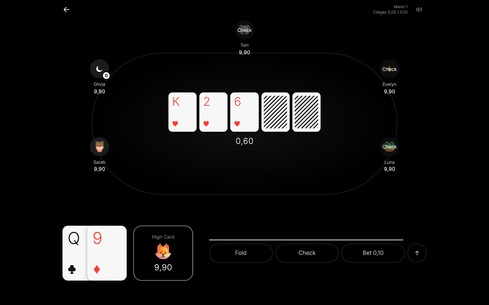
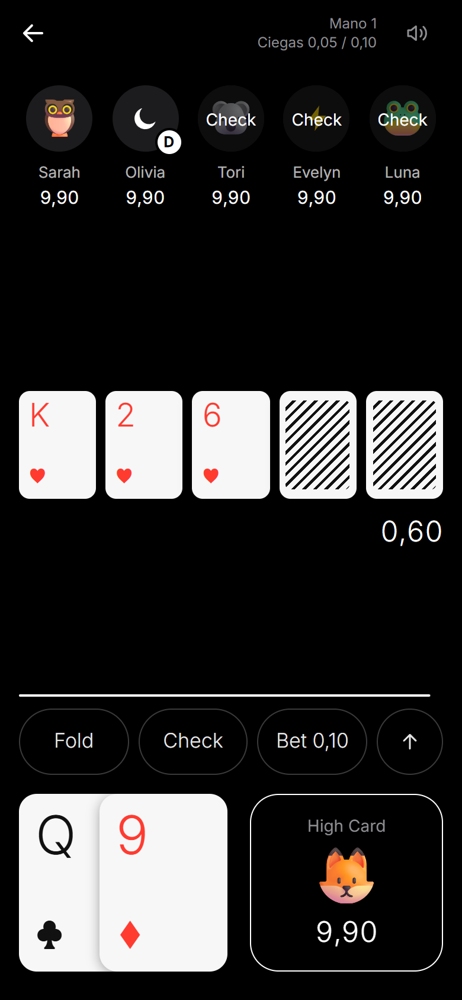
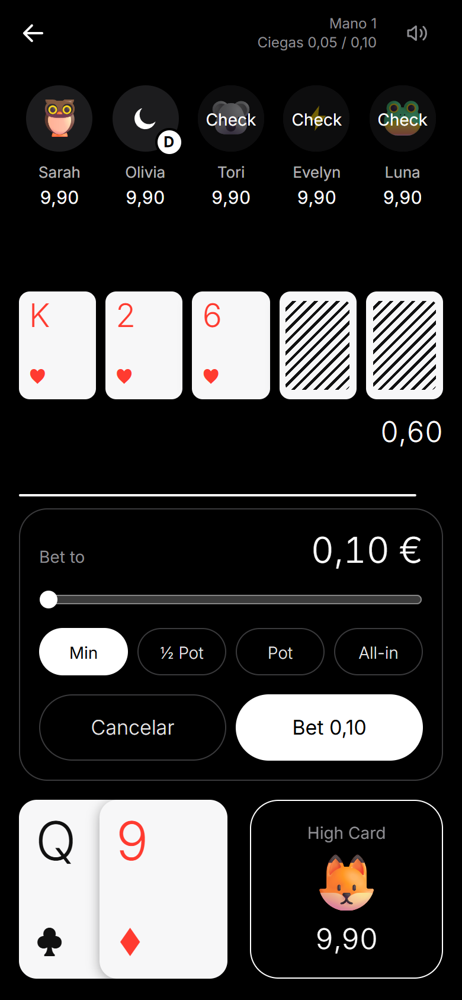
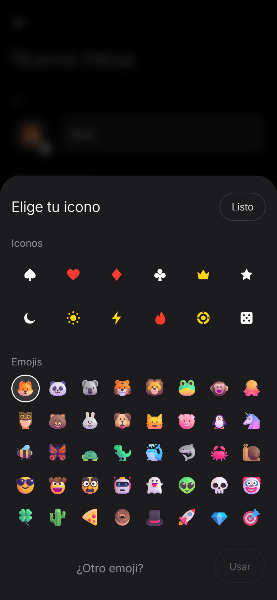
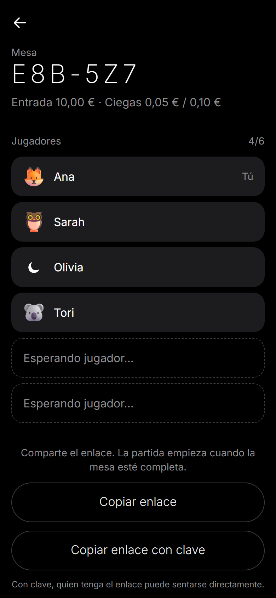
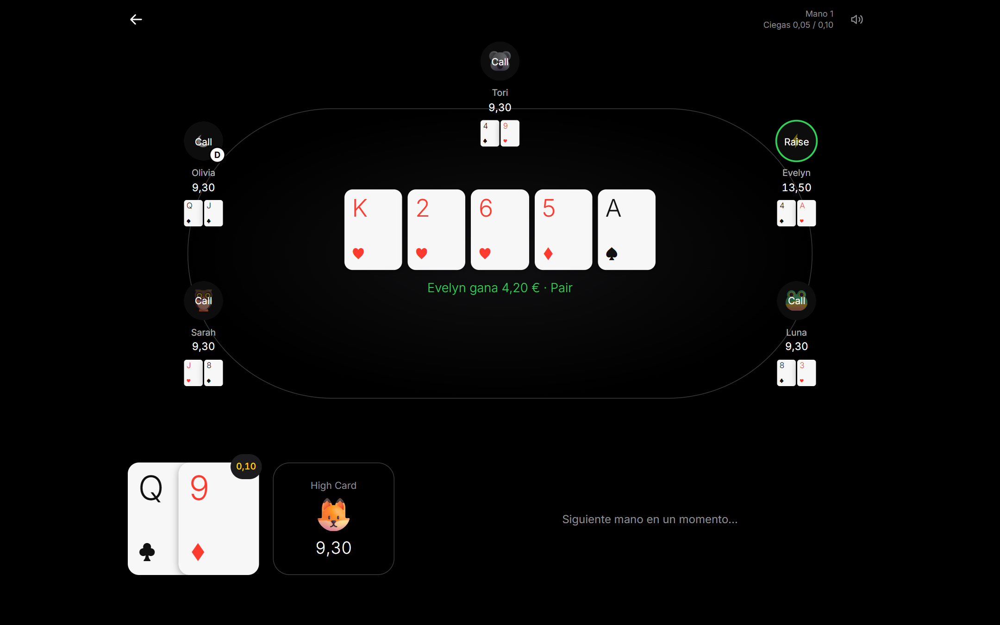
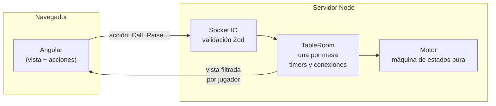

<div align="center">

# Solo Poker

**Póker Texas Hold'em con amigos, en el navegador y sin registros.**
Crea una mesa, comparte el enlace y la partida empieza en cuanto se sientan todos.

[](https://github.com/indentando/solo-poker/actions/workflows/ci.yml)
[](LICENSE)


**Español** · [English](README.en.md)



</div>

## Qué es

Solo Poker es una app web para jugar partidas privadas de **Texas Hold'em No-Limit** con amigos. Sin cuentas ni descargas: eliges un nombre y un icono, creas una mesa con clave y compartes el enlace. Las fichas son virtuales, pero se muestran como importes reales en euros para que la partida se sienta como en casa.

El diseño es deliberadamente minimalista: fondo negro, tipografía fina y nada que distraiga de las cartas. En el móvil todo cabe en una columna; en el ordenador la partida se convierte en una mesa ovalada.

<div align="center">
&nbsp;
&nbsp;
&nbsp;

</div>

## Características

**La partida**
- Texas Hold'em No-Limit completo: ciegas, botón rotatorio, subida mínima, all-in y **botes paralelos** (side pots) cuando varios jugadores van all-in con cantidades distintas.
- Reglas finas: un all-in corto no reabre la apuesta, la regla especial de ciegas del heads-up, devolución de lo que nadie iguala y reparto del céntimo sobrante en los empates.
- Ciegas que suben cada 10 minutos, eliminación al quedarse sin fichas y fin de partida con ganador.
- 30 segundos por turno: si se agota, el jugador pasa si puede y si no se retira.

**La mesa**
- Mesas de 2 a 9 jugadores con identificador corto (`K7X-92Q`) y clave.
- Enlace para compartir, con o sin la clave incluida.
- Reconexión automática: si se te bloquea el móvil o pierdes cobertura, tienes 45 segundos para volver sin perder tu sitio.
- Cada jugador elige un **icono**: 12 predeterminados planos o cualquier emoji. No se puede repetir en la misma mesa.
- **Sonidos** cortos y minimalistas para cada acción (check, apuesta, fold, reparto, aviso de tiempo…), generados en el propio navegador, con botón de silencio.

**Diseño**
- Mobile-first, con vista horizontal en pantallas grandes.
- Jerga de póker en inglés para las acciones (*Fold, Check, Call, Raise, All-in*) e interfaz en español.

<div align="center">

</div>

## Cómo está hecho

| Capa | Tecnología |
|---|---|
| Lenguaje | TypeScript en todo el proyecto (monorepo con npm workspaces) |
| Motor de juego | TypeScript puro, sin dependencias, testeado con Vitest |
| Servidor | Node.js + Socket.IO, validación con Zod |
| Web | Angular 22 (componentes standalone + signals), Tailwind CSS 4 |
| Sonido | Web Audio API: síntesis en el navegador, sin ficheros de audio |
| CI | GitHub Actions: tipos, tests y build en cada push |

### Arquitectura



Tres decisiones guían el diseño:

1. **El servidor es la única fuente de verdad.** Baraja, reparte, valida cada acción y decide quién gana. El navegador solo envía intenciones ("quiero subir a 0,40 €") y pinta lo que recibe.
2. **Cada jugador recibe solo su vista.** Nunca se envía el estado completo: las cartas de los rivales y la baraja no salen del servidor hasta el showdown. Ni con las herramientas de desarrollo se puede hacer trampa.
3. **El motor es puro y determinista.** Es una máquina de estados `(estado, acción) → (nuevo estado, eventos)`, sin red ni temporizadores. El azar y el reloj se inyectan, así que se puede testear a fondo. Incluye un test que juega 40 partidas completas con acciones al azar y comprueba en cada acción que no se crean ni se pierden fichas.

### Estructura

```
packages/
  engine/     Reglas del póker: manos, apuestas, botes, evaluador de jugadas
  protocol/   Contrato cliente-servidor compartido: eventos, tipos y validación
apps/
  server/     Servidor Socket.IO: mesas en memoria, turnos, reconexión, seguridad
  web/        App Angular: inicio, crear y unirse, sala de espera y mesa
```

## Ejecutarlo en local

Necesitas **Node.js 22** o superior.

```bash
git clone https://github.com/indentando/solo-poker.git
cd solo-poker
npm install
npm run dev
```

Abre `http://localhost:4200`, crea una mesa y comparte el enlace. El servidor escucha en la red local y muestra su IP al arrancar, así que puedes sentarte también desde el móvil. La primera vez, Windows puede pedirte permiso en el firewall.

| Comando | Qué hace |
|---|---|
| `npm run dev` | Arranca servidor (puerto 3000) y web (puerto 4200) |
| `npm test` | Tests del motor, el protocolo y el servidor |
| `npm run typecheck` | Comprobación de tipos de todos los paquetes |
| `npm run build` | Build de producción de la web en `apps/web/dist` |

> **Varios jugadores en el mismo navegador:** usa un origen distinto para cada uno, por ejemplo `http://localhost:4200` y `http://test.localhost:4200`. Las pestañas del mismo origen comparten la sesión.

## Próximamente

- [ ] Despliegue en [solo-poker.app](https://solo-poker.app)
- [ ] Recompras (rebuy) al quedarse sin fichas
- [ ] Elegir la velocidad de subida de las ciegas al crear la mesa
- [ ] Iconos personalizados
- [ ] Historial de manos

## Detalles técnicos

<details>
<summary><strong>Protocolo cliente-servidor</strong></summary>

<br>

Todos los mensajes del cliente se envían como `(payload, ack)` y el servidor responde siempre por el ack con `{ ok: true, … }` o `{ ok: false, error }`.

| Cliente → servidor | Respuesta |
|---|---|
| `table:create` `{ nickname, avatar, password, maxPlayers, buyIn }` | `{ tableId, playerId, token }` |
| `table:info` `{ tableId }` | `{ table }`, para la página del enlace |
| `table:join` `{ tableId, password, nickname, avatar }` | `{ tableId, playerId, token }` |
| `table:rejoin` `{ tableId, token }` | `{ tableId, playerId, token }` |
| `table:leave` `{}` | `{}` |
| `game:action` `{ handNumber, action }` | `{}` |

Del servidor al cliente: `table:view` (vista completa del jugador tras cada cambio), `game:events` (lo que acaba de pasar, para animar y sonar), `table:countdown` y `session:replaced`.

Los contratos están en [`packages/protocol`](packages/protocol/src/index.ts) y los comparten servidor y web, así que no se pueden desincronizar.

</details>

<details>
<summary><strong>Motor de juego</strong></summary>

<br>

- Todos los importes son **céntimos enteros** (`1000` = 10,00 €), para evitar errores de redondeo con decimales.
- [`getPlayerView(state, playerId)`](packages/engine/src/view.ts) es lo único que llega al cliente.
- Los botes paralelos se calculan a partir de lo que ha aportado cada jugador en la mano ([`pots.ts`](packages/engine/src/pots.ts)).
- El evaluador elige la mejor combinación de 5 cartas entre 7 y la codifica en un número comparable ([`evaluator.ts`](packages/engine/src/evaluator.ts)).
- La baraja se mezcla con Fisher-Yates usando el generador aleatorio criptográfico de Node.

</details>

<details>
<summary><strong>Servidor y seguridad</strong></summary>

<br>

- Una [`TableRoom`](apps/server/src/table-room.ts) por mesa: estado del motor, conexión de cada jugador y temporizadores (cuenta atrás de inicio, turno, pausa entre manos y margen de reconexión).
- Las claves de mesa se guardan con hash (scrypt) y se comparan en tiempo constante.
- Límite de intentos por IP al crear mesas y al unirse, para frenar la fuerza bruta.
- Todo lo que llega del cliente se valida con Zod. Los iconos solo pueden ser un emoji único o un predeterminado de la lista.
- La sesión se identifica con un token aleatorio de 256 bits guardado en el navegador. Si se abre en otra pestaña, la anterior se cierra con aviso.
- En el enlace con clave, la clave va en el fragmento (`/mesa/K7X-92Q#k=…`): el fragmento nunca se envía al servidor y la app lo borra de la barra de direcciones.

Variables de entorno: `PORT` (3000), `HOST` (`0.0.0.0`) y `CORS_ORIGIN` (orígenes separados por comas; en producción, `https://solo-poker.app`).

</details>

<details>
<summary><strong>Web</strong></summary>

<br>

- Rutas: `/` (inicio), `/crear` (nueva mesa) y `/mesa/:id` (unirse, sala de espera y partida).
- [`TableService`](apps/web/src/app/core/table.service.ts) guarda la última vista recibida en un signal.
- En desarrollo, `ng serve` reenvía `/socket.io` al servidor con [`proxy.conf.json`](apps/web/proxy.conf.json).
- **Iconos:** se guardan como texto, `e:🦊` (emoji) o `p:spade` (predeterminado). Para añadir un predeterminado, añade su id en [`avatars.ts`](packages/protocol/src/avatars.ts) y su dibujo SVG en [`avatar-presets.ts`](apps/web/src/app/ui/avatar-presets.ts).
- **Sonidos:** cada uno es una receta corta de osciladores y ruido filtrado en [`sound.service.ts`](apps/web/src/app/core/sound.service.ts). Para retocarlos, cambia su frecuencia, volumen (`peak`) o duración (`decay`).

</details>

## Licencia

[MIT](LICENSE) © 2026 Alex Dorado
